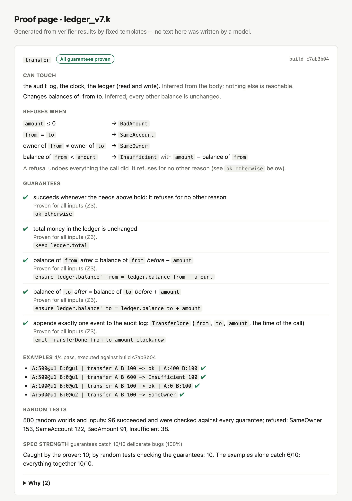

# Kern

**A research prototype of a programming language where AI agents write the code and humans review
proofs, not diffs.**

Agents can now write code faster than anyone can review it. Reading diffs line by line doesn't
scale, and agents have the same problem: to call a function safely, an agent reads its body, then
its callees' bodies, and its context fills with code it only needed a summary of. Kern is built
around one idea: **if every interface is machine-checked, nobody has to read the bodies.** The
agent reads a short, proven spec instead. The human reads a proof page generated from the
verifier's results.

## What it looks like

A definition states what it needs, what it keeps and what it ensures. The body comes after.
Here is a money transfer with a bug in it, and a `payout` that calls it:

```text
transfer from:Account to:Account amount:Int
  need amount > 0 else BadAmount
  keep ledger.total
  ensure ledger.balance' from = ledger.balance from - amount
  ensure ledger.balance' to = ledger.balance to + amount
body
  ledger.debit from amount
  ledger.credit to amount

payout from:Account to:Account house:Account amount:Int fee:Int
  need fee >= 0 else BadAmount
  keep ledger.total
  ensure ledger.balance' from = ledger.balance from - amount - fee
body
  transfer from to amount
  transfer from house fee
```

`kern check` proves each claim with Z3, for every possible input, or refutes it with a concrete
counterexample that it has replayed in the interpreter:

```text
transfer [e7198d8d]  Broken guarantees
  ✔ keep ledger.total
  ✗ ensure ledger.balance' from = ledger.balance from - amount
      counterexample: eg A:0@u1 | transfer A A 1 -> ok | A:0
  ✗ ensure ledger.balance' to = ledger.balance to + amount
      counterexample: eg A:0@u1 | transfer A A 1 -> ok | A:0

payout [d8d99a9c]  Broken guarantees
  ! keep ledger.total   (relies on transfer, which is not proven)
  ! ensure ledger.balance' from = ledger.balance from - amount - fee   (relies on transfer, which is not proven)
```

A transfer to yourself leaves the balance unchanged. `payout`, which calls `transfer`, is marked
`!`: its proof is only as good as `transfer`'s spec. Add one line,
`need from != to else SameAccount`, and both are proven. `payout` now lists `SameAccount` among
the ways it can fail, without being edited, because failures are inferred, not declared.

An agent that calls `payout` reads its spec view (65 tokens), never the bodies:

```text
payout from:Account to:Account house:Account amount:Int fee:Int
  uses ledger.write
  writes from to house
  fails BadAmount SameAccount
  need fee >= 0 else BadAmount
  keep ledger.total
  ensure ledger.balance' from = ledger.balance from - amount - fee
  proof ok
```

The same bug in a fuller module is step 1 of [examples/ledger-tour](examples/ledger-tour/), seven
versions of one ledger, each fixing what the previous proof page showed.

## The proof page

The page is what the human reads. `kern check --html` renders one card per definition. This is
`transfer` in the tour's last step
([examples/ledger-tour/proof-pages/ledger_v7.html](examples/ledger-tour/proof-pages/ledger_v7.html)):

<picture>
  <source media="(prefers-color-scheme: dark)" srcset="docs/images/proof-page-dark.png">
  
</picture>

Read a card from top to bottom:

- **The badge** is the verdict for the whole definition: "All guarantees proven", "Broken
  guarantees", "Tested only, not proven" and so on. `build` is the definition's hash. The examples
  ran against that build, and the `why` entries are anchored to it.
- **Can touch** is inferred from the body, not written by the author. It lists the effects the call
  can reach and the balances it can change. If a definition changes a balance that no guarantee
  mentions, an orange line says so. On the same page, payout's card says "No guarantee says what
  the new balance of `to`, `house` is."
- **Refuses when** lists every way the call can fail, with the failure it returns. Refusals that
  come from a callee are marked "(from transfer)". A refusal rolls back the whole call. Conditions
  are about the state before the call: one checked after the call's own changes is restated that way,
  or marked "(after this call's earlier changes)".
- **Guarantees** are the claims. Each one is in plain English from a fixed template, with how it
  was established and the spec line it came from.
  - ✔ is proven for all inputs.
  - ✗ is refuted, with a counterexample replayed in the interpreter. Step 1 of the tour shows one:
    [ledger_v1.html](examples/ledger-tour/proof-pages/ledger_v1.html).
  - `!` relies on something unproven.
  - `?` means the prover gave no answer, or its counterexample didn't replay.
  - ⊙ relies on an assumed handler.
- **Examples** and **random tests** are evidence, not proof. The `eg` lines are run, and every
  success in 500 random worlds is checked against every guarantee.
- **Spec strength** plants deliberate bugs in the body (mutants) and counts how many the guarantees
  catch. A bug that survives points at a missing guarantee. Strength is measured only when every
  guarantee holds.
- **Why** is folded away. It holds rationale, never rules, and it is flagged stale when the
  definition or its interface changes.

The page answers whether the code does what its spec says. The reviewer's job is the other
question: is this the right spec? Whether a person can answer that from the page alone is
challenge C4, which hasn't been run yet.

## Why this design

- **Verification is what licenses not reading.** Skipping a callee's body is safe only if its
  interface is proven. The prover follows the same rule: a call is verified from the callee's
  spec, never its body. So what the agent reads and what the proof relies on are the same thing.
- **The proof page is never model-written.** It is rendered from verifier results by fixed
  templates. A model narrating code would describe its bugs fluently. A template can't claim more
  than the checks established.
- **Every claim carries its strength.** ✔ proven for all inputs, ✗ refuted with a replayed
  counterexample, `!` relies on something unproven, `?` no answer. Weakness propagates to every
  caller. The spec's strength is measured too: how many deliberate bugs in the body
  (mutants) the guarantees catch.
- **Nothing that must be obeyed lives in a comment.** A rule goes in the spec, where it is
  checked. Rationale (`why`) lives in a separate file, anchored to the code's hash, and is flagged
  stale when the code or its inferred interface changes. Prose that reads like a rule ("must …")
  is flagged too.
- **Derive, don't declare.** Effects, failures and the set of written state are inferred through
  every callee. Anything a compiler can work out is not written, so it can't be wrong.
- **Failure is atomic and effects are closed.** A refusal rolls back the whole call, and every
  effect goes through a handler. That makes effect inference exact and every run replayable.

The reasoning behind each of these, and the tests that hold the code to them:
[docs/FUNDAMENTALS.md](docs/FUNDAMENTALS.md).

## What has been measured

The challenges (C1, C2, C6) were pre-registered: their pass thresholds were frozen before each run,
and a failure is reported as a failure. The language comparison is a measurement on one program.

| Question | Result | Source |
|---|---|---|
| Does a proven spec catch real bugs? | 24 seeded bugs (those expressible in Kern) in a 10-definition escrow app: Kern caught 23, TypeScript's and Go's test suites caught 13 each | [C1](docs/research/CHALLENGE.md) |
| Is it cheaper to write? | the same behaviour in 43% fewer tokens than TypeScript and 51% fewer than Go, while also carrying 710 tokens of proven spec | [COMPARE](docs/research/COMPARE.md) |
| Is it cheaper to read? | to use a function, an agent reads its spec view: median 130 tokens, against 574 (TS) and 666 (Go) for the function and its callees | [COMPARE](docs/research/COMPARE.md) |
| Can an agent write it with no training data? | three change tasks on the escrow app, given only the language reference (about 2,100 tokens): 18 of 18 Kern runs passed all 600 hidden acceptance cases with no guarantee broken, as did 9 of 9 TypeScript runs. 17 of the 18 passed `check` on the first try. Three runs per cell, so the arms can't be told apart on success | [C2](docs/research/CHALLENGE.md) |
| Does the proof page tell the truth? | a soundness fuzzer ran 677 random programs 228,300 times in the interpreter: 0 claims on a proof page contradicted. Three planted prover bugs were each found | [validation](validation/README.md) |

Token counts use the Claude tokenizer bundled in `anthropic==0.34.2`, an older one, so they are
approximate.

### Where it falls short

- **The C2 token threshold failed.** Working through views cost 1.03–1.33× the tokens of
  TypeScript (0.97–1.06× counting cache reads), against a frozen target of 0.7×. Two things cost
  more than the views saved on a 10-definition module. One is the language reference, paid on the
  first request. The other is the editor views themselves: on one of the three tasks they read
  more tokens than the whole module. The saving should grow with the program; that is not yet shown.
- **A proven spec can still be the wrong spec.** Kern proves that the code does what the spec says,
  not that the spec says the right thing. The one seeded bug that every language missed was a
  dropped condition in a spec. Whether a reviewer catches such bugs on the proof page (C4), and
  whether an agent can game a green page (C3), hasn't been tested.
- **The prover's speed has little margin.** On the Python toolchain, C6 failed both speed
  thresholds (16 s per definition at depth 6 with 4 `if`s). The Rust toolchain passes both (0.85–0.91
  s against 1 s). That margin is about one `if`, because each `if` still doubles the paths.
- **At a leaf, Kern doesn't win.** The savings come from callees read as specs, not from the
  syntax.
- **One author, one model family.** The same agent wrote the Kern, TypeScript and Go versions, in
  a ledger domain that suits Kern. C2's "cold" authors were the same model family that designed
  Kern.
- **A small language.** `Int` and `Account` are the only parameter types, so far. There are no
  records and no text. Loops are bounded and can't be nested. The ledger, clock and audit
  handlers are built in.

Every known shortcoming, with its evidence and what would count as fixing it, is in
[docs/research/SHORTCOMINGS.md](docs/research/SHORTCOMINGS.md).

## What exists

Kern is one Rust binary, `kern` (about 12,500 lines), with Z3 as the prover. It contains:

- `check`, which proves, runs the examples, runs random tests and measures spec strength;
- the proof page (HTML);
- the agent views;
- an MCP server, so an agent works through views and structural edits instead of files;
- packages of several files;
- a compiler to native code through Rust, with a small runtime crate;
- `kern host`, which runs a module for real, with SQLite state, HTTP, an outbox, network calls
  and deterministic replay.

[examples/](examples/) has ten standalone projects, from the ledger tour to a small web app.
`cargo test --workspace --release` runs 284 tests: an adversarial test suite per design
fundamental, golden outputs, the toolchain's own checks, and a gap test for each known shortcoming.

What's next: records, `match`, and the central experiment: the same tasks done in editor view
versus full source, measuring tokens, task success and how often the agent breaks a guarantee it
never read.

## Try it

```text
brew install z3                    # Z3 5.3.3 (or build it in: --features static-z3)
cargo install --path kern
kern check examples/ledger-tour/ledger_v1.k --why examples/ledger-tour/ledger.why --html build/proof.html
                                   # step 1 of the tour: refuted on purpose, so it exits 1
```

Or, with nothing but Docker: `docker build -t kern .`, then
`docker run --rm -v "$PWD:/work" kern check examples/shop --quick`.

## Documentation

| Read | For |
|---|---|
| [docs/REFERENCE.md](docs/REFERENCE.md) | the language, on one page |
| [docs/GUIDE.md](docs/GUIDE.md) | how to work with it: install, the edit-check loop, every command, file formats, the Rust API |
| [docs/HOST.md](docs/HOST.md) | how Kern programs reach the outside world |
| [docs/FUNDAMENTALS.md](docs/FUNDAMENTALS.md) | the design principles and the three bets |
| [docs/research/](docs/research/README.md) | plans, pre-registered scorecards and results |
| [AGENTS.md](AGENTS.md) | working rules for agents contributing to Kern |

## Repository layout

| Path | What it is | Ships? |
|---|---|---|
| `kern/` | the toolchain (crate and binary `kern`) | yes |
| `runtime/` | `kern-rt`, the crate every compiled program links with | yes |
| `docs/` | reference, guide, host design, fundamentals | docs |
| `examples/` | standalone example projects with their proof pages | no |
| `tests/probes/` | small modules the tests and validation tools use | no |
| `validation/` | tools that check the toolchain itself: fuzzer, digests, compiled-vs-interpreter | no |
| `experiments/` | the measurements behind the claims above | no |
| `build/` | generated output (ignored by git) | no |
